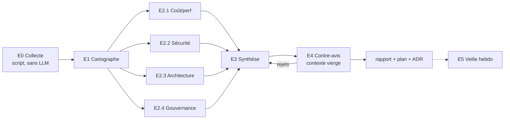

# Audit CI — instructions pour agents

Ce dossier contient les instructions d'un audit multi-agents de la CI `trowaflo/*` : ce repo de reusable workflows **et** ses repos appelants. Il ne contient pas l'audit lui-même, seulement de quoi le lancer et le relancer.

## Objectifs

| Axe | Question à laquelle l'audit répond |
| --- | --- |
| Coût / temps | Où partent les 2000 min/mois du plan Free, et comment les diviser sans perdre de garde-fou ? |
| Sécurité | Le niveau atteint est-il celui d'une équipe pro, avec uniquement des outils gratuits ? Qu'est-ce qui manque encore ? |
| Optimisation | Le découpage actuel est-il un monolithe ? Qu'est-ce qui tourne pour rien ? |
| Portabilité / versioning | Quel modèle permet de réagir en un point à une supply chain attack, de centraliser la décision de version des dépendances CI, et de versionner sans tout remonter à chaque changement ? |
| Gouvernance | Qui peut modifier ce qui contrôle toute la CI ? Faut-il passer en organisation GitHub gratuite ? |

## Livrables attendus

1. `rapport.md` : constats vérifiés, sévérité, preuve `fichier:ligne` ou donnée mesurée.
2. `plan.md` : roadmap priorisée impact × effort, chaque étape testable en PR preview avant merge.
3. `adr-architecture-cible.md` : 2 à 3 architectures cibles comparées, une recommandation tranchée.
4. Une veille hebdomadaire planifiée (phase E5), si validée à la lecture du plan.

Les livrables sont écrits dans le **vault perso** (repo privé `trowaflo/MyObsidianNotes`), dossier `02-Perso/Infra/Audit CI/<AAAA-MM-JJ>/`. Jamais dans ce repo : il est public, un rapport de failles n'y a pas sa place avant correction. Les données brutes de la collecte restent hors du vault (voir [`orchestrateur.md`](orchestrateur.md)).

## Workflow



Principe : **les outils assurent le rappel, les LLM la précision.** Aucun agent n'estime une durée, un coût ou une présence de faille : il la lit dans les exports de E0 ou dans le code.

## Modèles et effort

| Phase | Rôle | Modèle | Effort | Pourquoi |
| --- | --- | --- | --- | --- |
| E0 | Collecte | aucun (script) | — | Déterministe, rejouable, pas de token LLM sur des milliers de runs |
| E1 | Cartographe | Sonnet 5.5 | medium | Extraction structurée, peu de jugement |
| E2.1 | Coût / perf | Sonnet 5.5 | high | Calcul sur données mesurées, raisonnement borné |
| E2.2 | Sécurité | Opus 5.5 | high | Triage de faux positifs, chaînes d'attaque multi-fichiers |
| E2.3 | Architecture | Opus 5.5 | high | Arbitrages de design, options concurrentes |
| E2.4 | Gouvernance | Sonnet 5.5 | medium | Lecture de settings et de Terraform |
| E3 | Synthèse | Opus 5.5 | high | Dédup, priorisation, ADR |
| E4 | Contre-avis | Opus 5.5 | high | Doit pouvoir contredire E3, donc au moins aussi fort |
| E5 | Veille | Haiku 5.5 → Sonnet 5.5 | low → medium | Croisement mécanique ; escalade seulement sur alerte |

Un orchestrateur unique (session principale, Opus 5.5, effort medium) enchaîne les phases. Il ne fait **aucune analyse** lui-même : il lance, transmet les chemins de fichiers, vérifie que chaque livrable respecte le format.

## Lancer l'audit

Depuis Claude Code, avec ce repo et le vault perso accessibles :

```text
Lis docs/audit/orchestrateur.md et exécute-le.
OUT  = <vault>/02-Perso/Infra/Audit CI/<AAAA-MM-JJ>/
DATA = ~/audit-ci-data/<AAAA-MM-JJ>/
```

Exécution recommandée : Claude Code local ou session cloud. **Jamais en GitHub Action** : ça consommerait le quota audité et confierait un token à un LLM exposé à du contenu non fiable (titres de PR, logs).

## Fichiers

| Fichier | Contenu |
| --- | --- |
| [`orchestrateur.md`](orchestrateur.md) | Prompt de la session principale, enchaînement des phases |
| [`brief-commun.md`](brief-commun.md) | Contexte, contraintes et format de constat, injectés dans **chaque** agent |
| [`agents/e0-collecte.md`](agents/e0-collecte.md) | Spécification du script de collecte |
| [`agents/e1-cartographe.md`](agents/e1-cartographe.md) | Graphe appelants → workflows → actions |
| [`agents/e2-1-cout-perf.md`](agents/e2-1-cout-perf.md) | Auditeur coût / performance |
| [`agents/e2-2-securite.md`](agents/e2-2-securite.md) | Auditeur sécurité |
| [`agents/e2-3-architecture.md`](agents/e2-3-architecture.md) | Auditeur architecture / portabilité / versioning |
| [`agents/e2-4-gouvernance.md`](agents/e2-4-gouvernance.md) | Auditeur gouvernance |
| [`agents/e3-synthese.md`](agents/e3-synthese.md) | Consolidation, plan, ADR |
| [`agents/e4-contre-avis.md`](agents/e4-contre-avis.md) | Vérification indépendante |
| [`agents/e5-veille.md`](agents/e5-veille.md) | Veille supply chain hebdomadaire |
